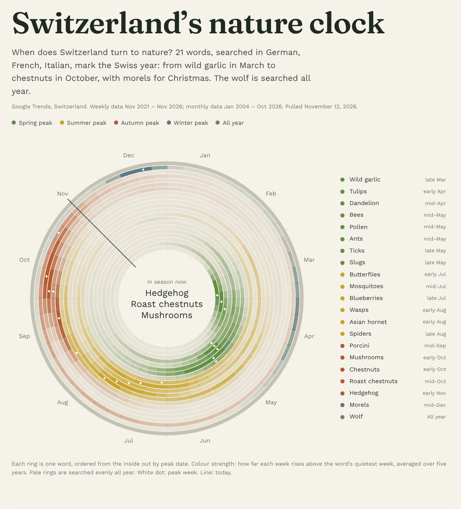
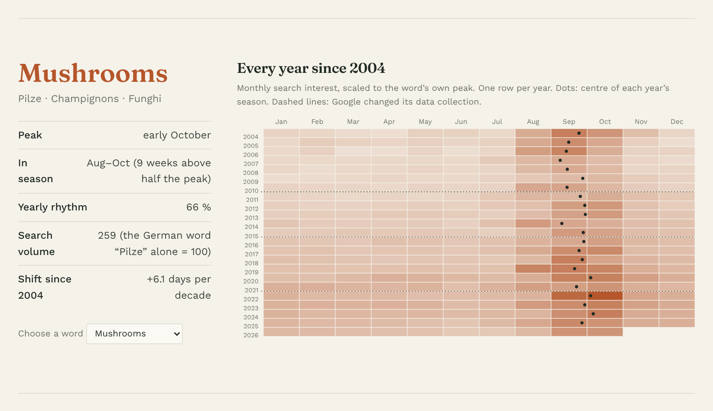
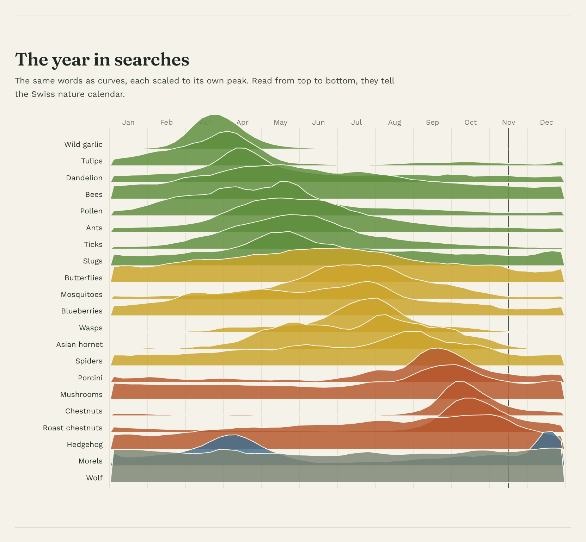
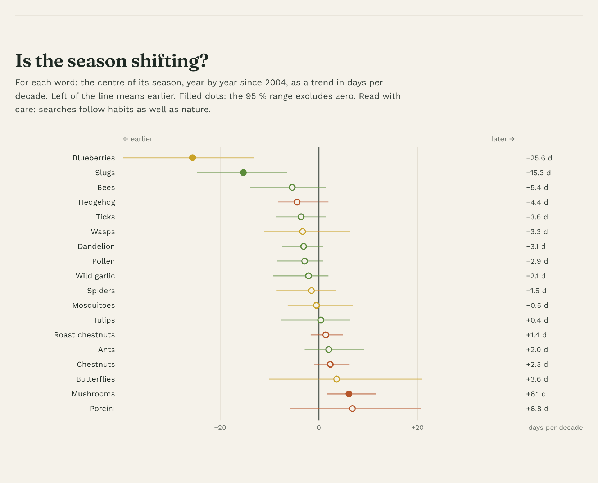

# Switzerland's nature clock

When does Switzerland turn to nature? Twenty-one nature words, searched in German, French, Italian, mark the Swiss year: from wild garlic in March to chestnuts in October, with morels for Christmas. The wolf is searched all year.

**Live site: https://datamat.github.io/nature-clock/**
Available in German, English, French, Italian: add `#de`, `#en`, `#fr` or `#it` to the address.

## What the site shows

- **The dial.** One ring per word, ordered from the inside out by peak date. Colour strength shows how far each week rises above the word's quietest week.
- **Each word since 2004.** Monthly search interest, one row per year, with the centre of each year's season.
- **The year in searches.** All words as curves, read from top to bottom like a calendar.
- **Season shift.** The trend of each season's centre since 2004, in days per decade.
- **Signal size.** Average search volume of all 61 candidate words.

| Each word since 2004 | The year in searches | Is the season shifting? |
|---|---|---|
|  |  |  |

## Data

- Source: [Google Trends](https://trends.google.com), region Switzerland.
- One request per word with its German, French, Italian term. The three share one scale, so the clock adds them up.
- The wolf uses Google's topic for the animal (`/m/084sq`), which covers all languages. The words "Wolf", "loup", "lupo" also mean other things.
- Weekly data from the past five years gives the shape of the year. Monthly data from 2004 shows change over time.
- Volume ranking: each candidate word was pulled together with the German word "Pilze" as a fixed reference ("Pilze" alone = 100).

## Method

- **Choosing the words.** 61 candidates on plants, fungi, insects, birds, mammals. Weather, sky, outdoor activities are left out. Words with too little volume or without a clear yearly rhythm (below 60 %) drop out; the twenty with the highest volume remain. The wolf is added by hand.
- **Yearly cycle.** Mean of each calendar week over five years, smoothed over three weeks. Peak = highest week. In season = weeks above half the peak. Yearly rhythm = (highest − lowest) / highest.
- **Shift.** For each year: the search-weighted mean date across the season's months. Trend: Theil–Sen slope with its 95 % range. A year counts only if every month of the season has measurable searches; a trend needs ten such years. Words peaking in December or January, or without a clear season, are left out.

## First results

- Mushroom season ("Pilze") moves about six days later per decade since 2004; the 95 % range excludes zero.
- Spring words lean earlier (wild garlic, pollen, ticks, dandelion: two to four days per decade), none significant on its own.
- Blueberries and slugs move strongly earlier. This most likely reflects spring gardening searches, not nature.

## Limits

- Searches measure attention, not nature itself. News can create spikes.
- Google changed its data collection in 2011, 2016, 2022.
- Monthly steps make the shift coarse: a few days per decade is at the edge of what the data can show.
- With twenty words tested, one or two may pass the 95 % test by chance.

## Running it yourself

The `project` folder holds everything needed. Windows, Python 3 with `numpy`, `pandas`, `matplotlib`. Double-click in order:

1. `1_Collect_data.bat` – pulls fresh Google Trends data into `01_Data_raw`
2. `2_Pick_top_20.bat` – re-ranks the candidate words (only needed when `candidates.csv` changes)
3. `3_Build_website.bat` – analysis, charts, website in `03_Outputs/website`
4. `4_Publish_to_GitHub.bat` – publishes the website, this README plus the project folder

Google limits how fast it answers. If collecting fails with "429", try again later.

## Author

Matthias Häni. Personal project. Data: Google Trends. Code written with help from Claude (Anthropic).
